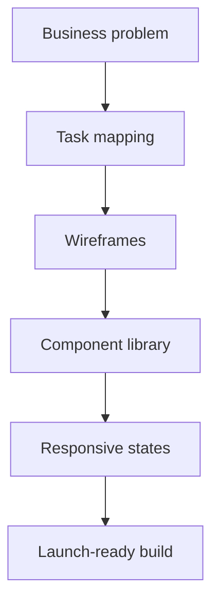
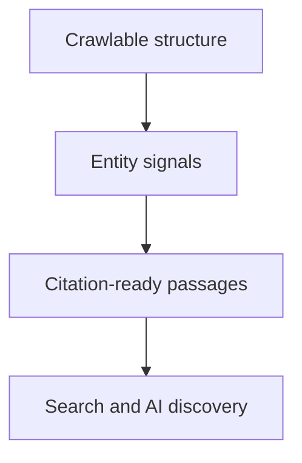
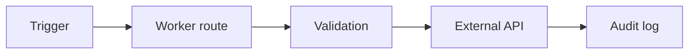
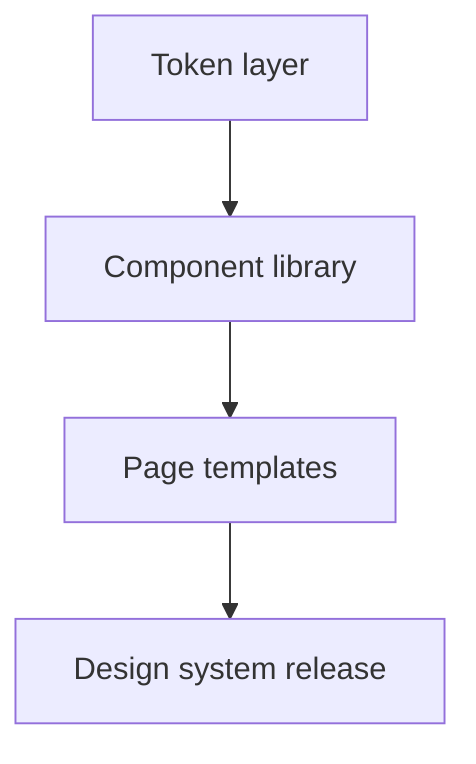
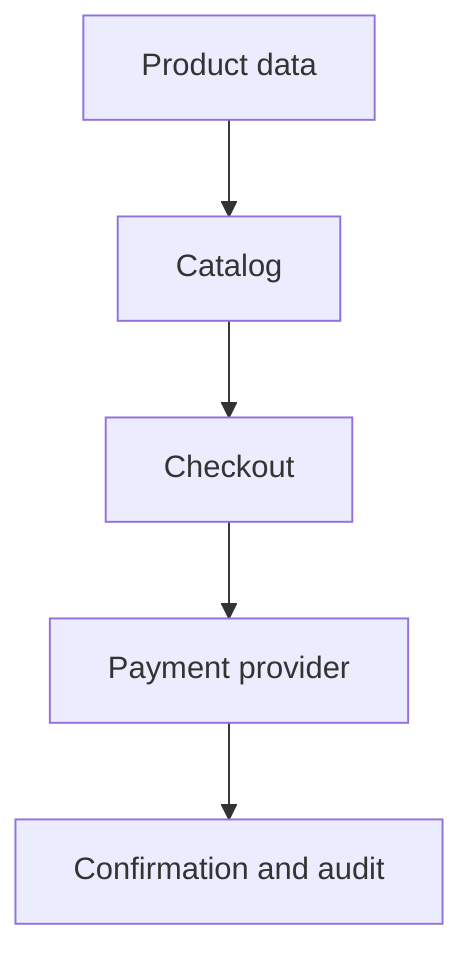

# Journal article drafts — Ancya Technologies

Draft journal articles for each service category. These are review materials only. They avoid unverified metrics, ranking promises, and fabricated client claims.

---

## 1. Web Design: Start from the decision path, not the template

### Core idea
Most poor websites are not poorly designed; they are decision trees that no one mapped. A visitor needs to understand what is sold, who it is for, what it costs, and what happens next.

### Technical angle
- content and navigation should support task order: find service → understand quality → compare price → contact
- component libraries reduce drift across page types
- accessibility, responsive layout, and performance are settled during design rather than audited after

### Diagram starter

### Deliverable
A grounded Journal article explaining why low-fidelity decision mapping expensive-looking layouts.

---

## 2. Web Development: What actually makes a small-business website ship reliably

### Core idea
Reliable web development is not about the loudest framework. It is about fewer moving parts, clear deploy boundaries, repeatable checks, and ownership.

### Technical angle
- static assets deployed from a clear boundary
- server-side form validation and recoverable failures
- security headers in application code
- documented routing and URL behaviour
- link and accessibility checks before production

### Diagram starter

### Deliverable
A practical article on reliable delivery rather than feature accumulation.

---

## 3. AI SEO & GEO: Make the site quotable, not padded

### Core idea
Search visibility improves when a page can be read, extracted, and cited. That requires structure, not synthetically long answer blocks.

### Technical angle
- concise lead paragraphs
- one H1 and logical headings
- schema structured around real entities
- canonical URLs and clean internal linking
- no fabricated statistics in indexed copy

### Diagram starter

### Deliverable
A Journal article explaining how structural clarity supports both traditional and generative search outcomes.

---

## 4. AI Automation: Start small, observable, and reversible

### Core idea
Automation fails when it covers hidden risk. The first workflow should be boring, event-driven, and easy to remove.

### Technical angle
- deterministic workflows before generative inference
- idempotent requests
- server-side validation and audit logging
- Workers as explicit boundaries for delivery
- secrets outside the repository

### Diagram starter

### Deliverable
A grounded Journal article on starting with small automations that survive real operational pressure.

---

## 5. Branding & Identity: Constraints that outlast campaigns

### Core idea
A brand system succeeds when it makes future pages easier to decide. That means tokens, type roles, motion rules, and concrete component examples rather than a mood board.

### Technical angle
- tokens for light and dark themes
- one shared stylesheet
- component examples and usage rules
- explicit system-change workflow
- version-aware design documentation

### Diagram starter

### Deliverable
A Journal article on constraints, token systems, and maintainable digital identity.

---

## 6. E-commerce: Clarity beats coupon theatre

### Core idea
E-commerce effectiveness begins with inventory truth, clear pricing, checkout recovery, and transactional trust — not with checkout distractions.

### Technical angle
- accessible checkout controls
- explicit errors and retry logic
- inventory and product-state clarity
- transaction security and secret handling
- ownership of store data and accounts

### Diagram starter

### Deliverable
A grounded Journal article focused on operational clarity over acquisition gimmicks.